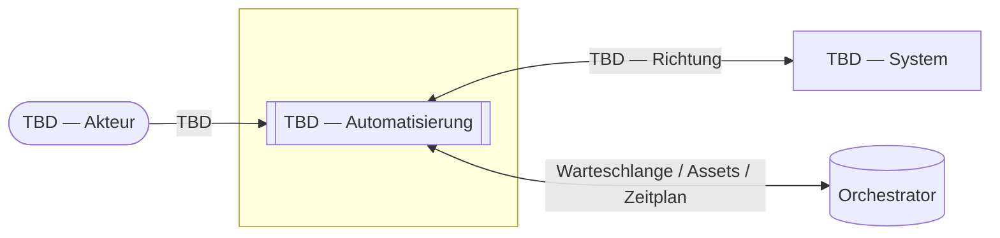

# Lösungsdesign-Dokument (SDD)

**Prozess- / Masterprojektname:** {{ process_name or "[TBD]" }}

<!-- #region sdd_header -->
| Position | Wert |
| --- | --- |
| SDD-Version | 0.1 |
| SDD-Datum | [JJJJ-MM-TT] |
| SDD-Status | Entwurf |
| PDD-Referenz | [TBD] |
<!-- #endregion sdd_header -->

## Dokumentenhistorie

<!-- #region sdd_history -->
| Version | Datum | Autor | Rolle | Änderungen |
| --- | --- | --- | --- | --- |
| 1.0 | [JJJJ-MM-TT] | [TBD] | Solution Architect | Erster Entwurf |
<!-- #endregion sdd_history -->

## Freigaben

<!-- #region sdd_approvals -->
| Version | Rolle | Name | Abteilung | Datum |
| --- | --- | --- | --- | --- |
| 1.0 | Solution Architect | [TBD] | [TBD] | |
| 1.0 | Entwicklungsleitung | [TBD] | [TBD] | |
| 1.0 | Prozessverantwortlicher | [TBD] | [TBD] | |
<!-- #endregion sdd_approvals -->

## 1. Zweck und Umfang

### 1.1 Zweck

[TBD — 3–5 Sätze: was die Automatisierung tut, Eingaben, Ausgaben, wichtige Designentscheidungen]

Designprioritäten: **Robustheit · Skalierbarkeit · Effizienz · Wiederverwendbarkeit**

Aus PDD Abschnitt 1.1 übernommen — im PDD ändern; das SDD neu erzeugen, um Änderungen zu übernehmen.

<!-- #region objectives -->
- [TBD]
- [TBD]
<!-- #endregion objectives -->

### 1.2 Umfang

Aus PDD Abschnitt 3.3 übernommen — im PDD ändern; das SDD neu erzeugen, um Änderungen zu übernehmen.

#### Im Umfang

<!-- #region in_scope -->
| Schritt | Beschreibung |
| --- | --- |
| [TBD] | |
<!-- #endregion in_scope -->

#### Außerhalb des Umfangs

<!-- #region out_of_scope -->
| Tätigkeit / Schritt | Grund | Auswirkung auf TO-BE | Weg zur künftigen Automatisierung |
| --- | --- | --- | --- |
| [TBD] | | | |
<!-- #endregion out_of_scope -->

### 1.3 Randbedingungen und Annahmen

Technische Randbedingungen und Designannahmen festhalten, die die Lösung begrenzen, damit Entwickler wissen, was sie nicht ändern können und was sie als gegeben voraussetzen.

<!-- Welche technischen Randbedingungen gelten — Netzwerk, Zugriff, Leistung? Welche Designannahmen werden zu Datenqualität, Mengenstabilität oder nachgelagerten Systemen getroffen? -->

<!-- #region constraints -->
| # | Art | Aussage |
| --- | --- | --- |
| 1 | Randbedingung | [TBD] |
| 2 | Annahme | [TBD] |
<!-- #endregion constraints -->

## 2. Kontext

### 2.1 Beteiligte

Alle wichtigen Ansprechpartner festhalten, damit jedes Teammitglied weiß, an wen es sich für fachliche Entscheidungen, Freigaben, Systemzugriff und Compliance wenden kann.

<!-- Wer sind die wichtigen Ansprechpartner? Für das PDD: Prozessverantwortlicher, fachlicher Auftraggeber, BA, PM, Vertreter des Betriebsrats und Datenschutzbeauftragter. Für das SDD: technische Ansprechpartner je System — wen man für Firewall-Regeln, Kontenbereitstellung und Zugriffsanfragen anspricht. -->

<!-- #region contacts_technical -->
[TBD]
<!-- #endregion contacts_technical -->

### 2.2 Technologieüberblick

Die gewählte UiPath-Plattformkonfiguration festhalten, die für die Prüfung durch den Betriebsrat und die Bereitstellung der Infrastruktur nötig ist. Begründung und Alternativen gehören in ADRs.

<!-- Welche UiPath-Laufzeitkomponenten sind nötig — Robotertyp (unbeaufsichtigt/beaufsichtigt), Orchestrator-Typ (Cloud/Suite), Ausführungsmodus (XAML/Coded/Hybrid) und Anforderungen an die Skalierbarkeit? Nur die gewählten Werte nennen; das Warum in docs/adr/ dokumentieren. -->

<!-- #region technology_overview -->
| Ebene | Komponente | Auswahl |
| --- | --- | --- |
| Discovery | Process Mining | TBD |
| Discovery | Task Mining | TBD |
| Discovery | Communications Mining (Discovery) | TBD |
| Automatisierung | RPA — Unbeaufsichtigt / VM-Roboter (BOR) | TBD |
| Automatisierung | RPA — Beaufsichtigt (FOR) | TBD |
| Automatisierung | Integration Service (API-Konnektoren) | TBD |
| Automatisierung | Maestro / Workflow-Orchestrierung | TBD |
| Automatisierung | Agents (agentisch / LLM-gesteuert) | TBD |
| Automatisierung | Testautomatisierung (Test Suite) | TBD |
| Kognitiv / KI | Document Understanding / IDP | TBD |
| Kognitiv / KI | AI Center (eigene Modelle) | TBD |
| Kognitiv / KI | Communications Mining (Laufzeit) | TBD |
| Mensch in der Schleife | Action Center | TBD |
| Mensch in der Schleife | Apps (eigene Oberfläche) | TBD |
| Daten & Berichte | Data Service | TBD |
| Daten & Berichte | Insights | TBD |
| Daten & Berichte | Process Mining (operativ) | TBD |
| Infrastruktur | Automation Cloud (SaaS) | TBD |
| Infrastruktur | Automation Suite (On-Premise / k8s) | TBD |
| Infrastruktur | Serverless-Roboter | TBD |
| Infrastruktur | VM-basierte Roboter | TBD |
<!-- #endregion technology_overview -->

<!-- #region technology_config -->
| Position | Wert |
| --- | --- |
| UiPath-Version | [TBD] |
| Ausführungsmodus | XAML / Coded C# / Hybrid |
<!-- #endregion technology_config -->

## 3. Architektur

### 3.1 Systemkontext *(C4 Ebene 1)*

Die Automatisierung in ihrer Umgebung — externe Akteure, verbundene Systeme und die Grenze der Automatisierung. Keine interne Struktur.

<!-- Mit welchen externen Systemen verbindet sich der Roboter, welche Daten fließen hinein und heraus, und welche Akteure (Menschen, vorgelagerte Prozesse) wirken auf die Automatisierung ein? -->

<!-- #region system_context -->
[TBD]
<!-- #endregion system_context -->

### 3.2 Prozessablauf

Durchgängiger zeitlicher Ablauf über alle Container — die technische Neufassung des TO-BE-Prozesses durch den SA als Mermaid-Sequenzdiagramm.

<!-- Den durchgängigen Ablauf über die Container beschreiben: zeitlicher Auslöser, Abfrage und Einstellen durch den Dispatcher, Schleife je Vorgang im Performer und Übergabe an einen Aggregator oder ein nachgelagertes System. -->

<!-- #region process_sequence -->
[TBD — Mermaid-Sequenzdiagramm. Reihenfolge der Teilnehmer: Akteur(e), vorgelagerte Systeme außerhalb des Umfangs, Quellsystem(e), Orchestrator, Dispatcher, Performer, Zielsystem(e). Je Vorgang durchläuft der Performer in einer Schleife initialize → ingest → enrich → decide → execute → complete → finalize. Siehe snippets/process_sequence.example.de.md.]
<!-- #endregion process_sequence -->

### 3.3 Container *(C4 Ebene 2)*

Bereitstellbare UiPath-Projekte mit Framework, Auslöser, Robotertyp und Vertrag der Warteschlange — die Sicht der C4-Ebene 2.

<!-- Wie viele bereitstellbare Projekte sind nötig (Dispatcher, Performer, Aggregator)? Was löst jedes aus, welches Framework nutzt jedes, und welche Orchestrator-Warteschlange verbindet sie? -->

<!-- #region containers -->
| # | Komponente | Archetyp | Framework | Auslöser | Laufzeit | Grenze der Warteschlange |
| --- | --- | --- | --- | --- | --- | --- |
| 1 | `[TBD]_Dispatcher` | rpa_dispatcher | Linearer Workflow | Zeitgesteuert — [TBD] | Unbeaufsichtigt | Schreibt → `[TBD]` |
| 2 | `[TBD]_Performer` | rpa_performer | REFramework | Durch die Warteschlange ausgelöst + zeitgesteuertes Stoppsignal | Unbeaufsichtigt | Liest ← `[TBD]` |
| 3 | `[TBD]_Aggregator` | rpa_aggregator | Linearer Workflow | Zeitgesteuert — [TBD] | Unbeaufsichtigt | *(optional — entfernen, wenn nicht zutreffend)* |

**Vertrag der Warteschlange — `[TBD]`:** Der Vorgang trägt `[TBD — eindeutiges Referenzfeld]` als Schlüssel zur Duplikaterkennung. Der Dispatcher schreibt einen Vorgang je Quelldatensatz; der Performer liest und bearbeitet einen Vorgang je REFramework-Transaktion; der einzige Rückschreibevorgang vom Performer zum Orchestrator ist der Transaktionsstatus (Success / BusinessException / SystemException) und die Ausgabeeigenschaften.

> **Katalog der Komponenten-Archetypen:** `rpa_dispatcher` · `rpa_performer` · `rpa_aggregator` · `rpa_tool` · `maestro` · `agent` · `api_workflow` · `web_app` · `rpa_library`
<!-- #endregion containers -->

### 3.4 Komponentenverzeichnis *(C4 Ebene 3)*

Verzeichnis auf Modulebene mit stabilen IDs und Archetypen — die Sicht der C4-Ebene 3, die die Architektur mit Aufwandsschätzung und Testplanung verbindet.

<!-- Welches Modul behandelt je Pipeline-Stufe (shell, initialize, ingest, enrich, decide, execute, complete, finalize), welche Anwendung berührt es, über welche Schnittstelle, und welche Ausnahme-IDs löst es aus? -->

<!-- ID-Format: cmp_{stage}_{application_or_purpose} — Kleinbuchstaben, durch Unterstriche getrennt. IDs müssen stabil sein; Aufwandsschätzungen, ADRs und erzeugte Testaufgaben verweisen auf sie. enrich und execute können mehrere Zeilen haben — je Anwendung oder Verarbeitungsvariante eine hinzufügen. Standard-REFramework-Shell-Module (mit ‡ markiert) haben einen Katalogaufwand; prozessspezifische Module (mit † markiert) brauchen eine eigene Schätzung. -->

<!-- #region components -->
| ID | Stufe | Archetyp | Modul | Aufgabe | Anwendung | Schnittstelle | Erhält | Erzeugt | Ausnahmeverweise |
| --- | --- | --- | --- | --- | --- | --- | --- | --- | --- |
| cmp_shell_init | shell | standard_ref_shell | InitAllApplications ‡ | Vor der Transaktionsschleife alle Zielanwendungen öffnen und anmelden | [TBD] | ui | — | — | SE-01 |
| cmp_shell_close | shell | standard_ref_shell | CloseAllApplications ‡ | Alle geöffneten Anwendungen unabhängig vom Ausgang der Transaktion schließen | [TBD] | ui | — | — | — |
| cmp_init_validate | initialize | standard_ref_shell | Validate ‡ | Prüfen, dass die nötigen Felder des Vorgangs vorhanden sind; Transaktionsbereich initialisieren | — | — | TransactionItem | InitResult | BE-01 |
| [TBD] | ingest | [TBD] | Ingest[Source] † | Den vollständigen Quelldatensatz für diese Transaktion lesen | [TBD] | [TBD] | InitResult | RawData | SE-01 |
| [TBD] | enrich | [TBD] | Enrich[Reference] † | Um Referenzdaten oder Abfragen ergänzen, die nicht im Vorgang stehen | [TBD] | [TBD] | RawData | EnrichedItem | [TBD] |
| [TBD] | decide | rule_decide | Decide † | Geschäftsregeln anwenden; Verarbeitungspfad wählen; fachliche Ausnahmen erkennen | — | — | EnrichedItem | Decision | BE-01, BE-02 |
| [TBD] | execute | [TBD] | Execute[Target] † | Ergebnis in das Zielsystem schreiben — Hauptaktion der Automatisierung | [TBD] | [TBD] | Decision | ExecutionResult | SE-02 |
| [TBD] | complete | [TBD] | Complete[Source] † | Status im Quellsystem aktualisieren; Ausgabeeigenschaften des Orchestrators schreiben | [TBD] | [TBD] | ExecutionResult | CompletedItem | SE-01 |
| cmp_finalize | finalize | standard_ref_shell | Finalize ‡ | Ressourcen freigeben; strukturierten Prüfeintrag schreiben; Status an REFramework zurückgeben | — | — | CompletedItem | — | — |

> ‡ Standard-REFramework-Modul — Aufwand aus dem Katalog, keine eigene Schätzung.
> † Prozessspezifisch — Aufwand abhängig von Archetyp, Anwendung und Anzahl der Ausnahmen.
> **Katalog der Archetypen:** `standard_ref_shell` · `email_ingest` · `ui_ingest` · `api_ingest` · `file_ingest` · `file_parse` · `api_enrich` · `ui_enrich` · `db_enrich` · `dto_mapping` · `rule_decide` · `sap_gui_execute` · `api_execute` · `ui_execute` · `queue_enqueue` · `api_complete` · `ui_complete`
> Anwendungen, die noch nicht automatisiert wurden, brauchen zusätzlichen Aufwand für robuste Selektoren — mit dem Kennzeichen `previously_automated` der Anwendungsliste abgleichen.
<!-- #endregion components -->

### 3.5 Kapazitäts- und Durchsatzanalyse

Die Auslastung der Maschine gegen das Bearbeitungsfenster berechnen, um festzustellen, ob eine Laufzeit genügt oder skaliert werden muss.

<!-- Wie hoch ist die erwartete Auslastung der Maschine bei dem Volumen und der Zeit je Vorgang, und genügt eine Laufzeit? -->

<!-- #region volume -->
| Position | Wert |
| --- | --- |
| Tagesvolumen | [TBD] |
| Spitzenvolumen | [TBD] |
| Durchschnittliche Bearbeitungszeit (Min.) | [TBD] |
| Bearbeitungsfenster (Min.) | [TBD] |
| Vorgänge je Laufzeit und Tag | [TBD — Fenster ÷ Bearbeitungszeit] |
| Laufzeiten Normalbetrieb | [TBD] |
| Laufzeiten Spitze | [TBD] |
| Skalierbar | Ja / Nein |
| Service Level der Warteschlange | [TBD] |
<!-- #endregion volume -->

### 3.6 Empfohlene Anzahl der Laufzeiten

Die Mindestzahl der Laufzeiten festlegen, die das Service Level unter Spitzenlast einhält, damit die Infrastruktur richtig bereitgestellt wird.

<!-- Wie viele Laufzeiten sind auf Grundlage der Auslastungsanalyse bei normaler und bei Spitzenlast nötig, und welche Schwelle soll eine automatische Skalierung auslösen? -->

<!-- #region recommended_runtime_count -->
| Szenario | Volumen | Nötige Laufzeiten | Hinweise |
| --- | --- | --- | --- |
| Normallast | [TBD] | [TBD] | |
| Spitzenlast | [TBD] | [TBD] | Spitzenauslastung: [TBD]% |
| Auslöser der Skalierung | — | — | [TBD — Tiefe der Warteschlange / Zeitschwelle] |
<!-- #endregion recommended_runtime_count -->

### 3.7 ADR-Verzeichnis

Wichtige Architekturentscheidungen festhalten — Kontext, gewählte Option und in Kauf genommene Nachteile —, damit Prüfer und spätere Entwickler verstehen, warum die Umsetzung so aussieht. Die Quelldateien liegen in `docs/adr/` — mit `--adr-dir docs/adr/` rendern, mit `scripts/cpm_rpa/adr.py` zurücklesen.

<!-- Welche nicht offensichtlichen Designentscheidungen brauchen eine Begründung — Wahl des Frameworks, Ausführungsmodus, Strategie für Ausnahmen, Bereitstellungsmuster? Für jede Kontext, Entscheidung, Alternativen und Folgen dokumentieren. -->

<!-- #region adr_inventory -->
| ID | Titel | Status | Betrifft |
| --- | --- | --- | --- |
| [TBD] | [TBD] | [TBD] | [TBD] |
<!-- #endregion adr_inventory -->

## 4. Detailentwurf der Komponenten

Designentscheidungen und Laufzeitkonfiguration für jede Komponente aus Abschnitt 3.3. Ein Unterabschnitt je Komponente — die Überschrift kann der SA ändern; den Bereich darunter neu rendern, um den Inhalt aus dem Komponentenverzeichnis neu zu erzeugen.

### 4.1 `[TBD]` *(rpa_dispatcher)*

<!-- #region component_design_rpa_dispatcher -->
[TBD]
<!-- #endregion component_design_rpa_dispatcher -->

### 4.2 `[TBD]` *(rpa_performer)*

<!-- #region component_design_rpa_performer -->
[TBD]
<!-- #endregion component_design_rpa_performer -->

### 4.3 `[TBD]` *(rpa_aggregator)* *(optional — entfernen, wenn nicht zutreffend)*

<!-- #region component_design_rpa_aggregator -->
[TBD]
<!-- #endregion component_design_rpa_aggregator -->

### 4.4 `[TBD]` *(rpa_library)* *(optional — je Bibliothek einen Unterabschnitt hinzufügen; entfernen, wenn es keine gibt)*

<!-- #region component_design_rpa_library -->
[TBD]
<!-- #endregion component_design_rpa_library -->

## 5. Integrationsspezifikation

Abgeleitet — erzeugt aus den Anwendungen des AS-IS (`automation_surface`, `in_scope`), den Zugangsdaten / der Sicherheit (`auth_method`) und dem Komponentenverzeichnis (Stufe → Richtung). Nicht von Hand ändern; die Quellabschnitte aktualisieren.

<!-- #region integrations -->
| # | System | Integrationsart | Richtung | Authentifizierung |
| --- | --- | --- | --- | --- |
| 1 | [TBD] | REST-API / DB / UI / Datei | Lesen / Schreiben / Beides | OAuth / Basic / Windows |
<!-- #endregion integrations -->

## 6. Ausnahmebehandlung

Bekannte Anwendungsfehler festhalten und das Verhalten des Roboters bei der Wiederherstellung festlegen, damit Störungen im Betrieb in den erwarteten Grenzen bleiben.

<!-- Welche Anwendungsfehler, fehlgeschlagenen Anmeldungen, Zeitüberschreitungen oder Infrastrukturstörungen gab es bei diesem Prozess? Wie soll der Roboter jeweils reagieren? -->

### 6.1 Bekannte Anwendungsfehler

<!-- #region application_errors -->
[TBD]
<!-- #endregion application_errors -->

### 6.2 Standardwiederherstellung bei Systemausnahmen

<!-- #region default_se_handling -->
- Den aktuellen Schritt bis zu `[DEFAULT: 3]`-mal wiederholen
- Falls ungelöst: Fehler protokollieren, Alarm an `[TBD — ops@company.com]` senden, sauber beenden
<!-- #endregion default_se_handling -->

### 6.3 Ausnahmeart → Aktion des Roboters

<!-- #region exception_handling -->
| Ausnahmeart | Auslöser | Aktion des Roboters | Max. Wiederholungen | Eskalation |
| --- | --- | --- | --- | --- |
| Business Exception | Ungültige / unerwartete Daten | Protokollieren + Vorgang überspringen | 0 | E-Mail an BizOps |
| System Exception — bekannt | Absturz / Zeitüberschreitung der Anwendung | Anwendung neu starten + wiederholen | 3 | Betrieb alarmieren, wenn ungelöst |
| System Exception — unbekannt | Unerwarteter Fehler | Protokollieren + sauber beenden | 1 | Betrieb mit Screenshot alarmieren |
<!-- #endregion exception_handling -->

## 7. Berichte und Überwachung

Die Überwachungs- und Berichtsausgaben festlegen, die Fachbereich und Betrieb brauchen, um dem Roboter im Produktivbetrieb zu vertrauen und ihn zu pflegen.

<!-- Was muss der Fachbereich überwachen — Häufigkeit, Detailtiefe und Werkzeug? Was braucht der Betrieb, um den Roboter im Produktivbetrieb zu verfolgen? -->

Aus PDD Abschnitt 3.6 übernommen — im PDD ändern; das SDD neu erzeugen, um Änderungen zu übernehmen.

<!-- #region reporting_requirements -->
| Nr. | Berichtsart | Häufigkeit | Einzelheiten | Werkzeug |
| --- | --- | --- | --- | --- |
| 1 | Zusammenfassung der Prozessausführung | Täglich | Anzahl der Läufe, Dauer, Verhältnis Erfolg/Fehler | Orchestrator-Dashboard |
| 2 | Transaktionsprotokoll | Je Lauf | Status je Vorgang, Fehlerkategorie | Orchestrator |
| 3 | [TBD] | | | |
<!-- #endregion reporting_requirements -->

## 8. Sicherheit und Compliance

### 8.1 Voraussetzungen für den Systemzugriff

Jede Zugriffsschranke — Freigaben, Konten, Firewall-Regeln — benennen, die genommen sein muss, bevor der Roboter laufen kann, damit Hindernisse früh sichtbar werden.

<!-- Was muss für jedes System, mit dem sich der Roboter verbindet, vor dem Lauf geregelt sein — Freigabe des Systemverantwortlichen, Kontenbereitstellung, Firewall-Regeln, Freigabe fester IP-Adressen und weitere Zugriffsschritte? Wer ist für jede Aktion verantwortlich, und bis wann? -->

<!-- #region system_prerequisites -->
[TBD]
<!-- #endregion system_prerequisites -->

### 8.2 Zugriffskontrolle

Abgeleitet aus den Komponenten für Infrastruktur und Robotertyp in technology_overview und aus allen Zeilen „Robot Account“ in Abschnitt 8.1.

<!-- #region access_control -->
| Position | Wert |
| --- | --- |
| Roboterkonto | [TBD — eigenes Entra-ID-Automatisierungskonto; kein persönliches Entwicklerkonto] |
| Berechtigungsstufe | [TBD — lokaler Administrator / Standardbenutzer] |
| MFA / Sitzungsrichtlinie | [TBD] |
<!-- #endregion access_control -->

### 8.3 Verwaltung der Zugangsdaten

Sicherstellen, dass jede Anmeldung an einem System mit Authentifizierungsart, Asset-Typ und Rotationsregel dokumentiert ist, damit der Roboter sicher und wartbar ist.

<!-- Welche Zugangsdaten werden gebraucht, wie werden sie gespeichert, und welche Gesichtspunkte des Datenschutzes oder der Compliance gelten? -->
<!-- Asset-Typ: Credential für Paare aus Benutzername und Passwort; Text für Token, API-Schlüssel, private Schlüssel und URLs. Ein falscher Typ ist ein Fehler. -->

<!-- #region system_credentials -->
[TBD]
<!-- #endregion system_credentials -->

### 8.4 Datenschutz und Compliance

Den Umgang mit personenbezogenen Daten dokumentieren — Rechtsgrundlage nach DSGVO, Datensparsamkeit, Aufbewahrung und Stand der Mitbestimmung —, damit die Automatisierung die Anforderungen der Compliance erfüllt.

<!-- Welche personenbezogenen Daten verarbeitet der Roboter? Was ist die Rechtsgrundlage nach DSGVO? Wie lange wird aufbewahrt, und wie ist der Stand der Mitbestimmung? -->

<!-- #region data_protection -->
| Position | Wert |
| --- | --- |
| Personenbezogene Daten vorhanden | Ja / Nein |
| Rechtsgrundlage nach DSGVO | [TBD — z. B. Art. 6 Abs. 1 lit. b Vertragserfüllung] |
| Datensparsamkeit | [TBD — welche Daten nach der Verarbeitung behalten werden] |
| Aufbewahrung | [TBD] |
| Prüfpfad | Auftragsprotokolle des Orchestrators + Transaktionsprotokolle |
| Mitbestimmung / Betriebsrat | [TBD — erforderlich / nicht erforderlich / abgeschlossen] |
| Sonstige Compliance | [TBD] |
<!-- #endregion data_protection -->

## 9. Aufwandsschätzung

<!-- Maßgebliche Daten in `<process-name>-estimation.md` und `<process-name>-roi.md`. -->
<!-- Dieser Abschnitt ist eine Referenzzusammenfassung — in den Quelldokumenten ändern, dann neu erzeugen. -->

<!-- #region estimation_summary -->
| Position | Wert |
| --- | --- |
| Personentagessatz | [TBD] |
| Prozentsatz für Unvorhergesehenes | [TBD] |
| Basisaufwand gesamt (PT) | [TBD] |
| Gesamtaufwand (PT) | [TBD] |
| Baukosten | [TBD] |
<!-- #endregion estimation_summary -->

<!-- #region roi_summary -->
| Position | Wert |
| --- | --- |
| Monatliche Nettoeinsparung | [TBD] |
| Jährliche Nettoeinsparung | [TBD] |
| Amortisation (Monate) | [TBD] |
| Nettonutzen Jahr 1 | [TBD] |
| Nettonutzen Jahr 3 | [TBD] |
<!-- #endregion roi_summary -->

## 10. Beobachtungen

### 10.1 Künftige Verbesserungen

<!-- #region observations_improvement -->
- [ ] [TBD]
- [ ] [TBD]
<!-- #endregion observations_improvement -->

### 10.2 Aus dem Umfang genommen

<!-- #region observations_removal -->
*Nichts wurde aus dem Umfang genommen.*
<!-- #endregion observations_removal -->

## 11. Glossar

Siehe `[ProcessName]-glossary.md` im Projektordner.
